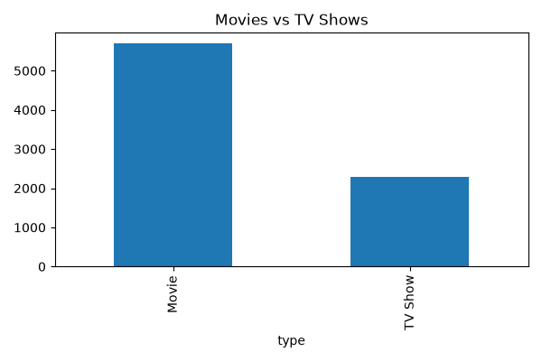
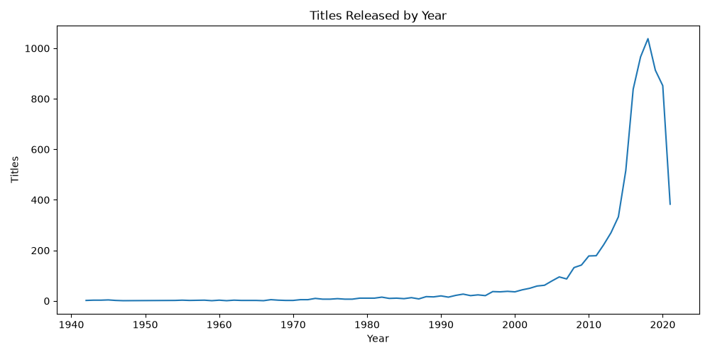
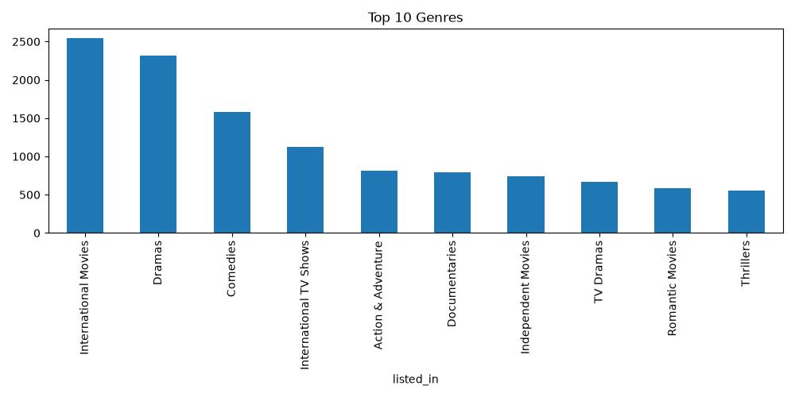
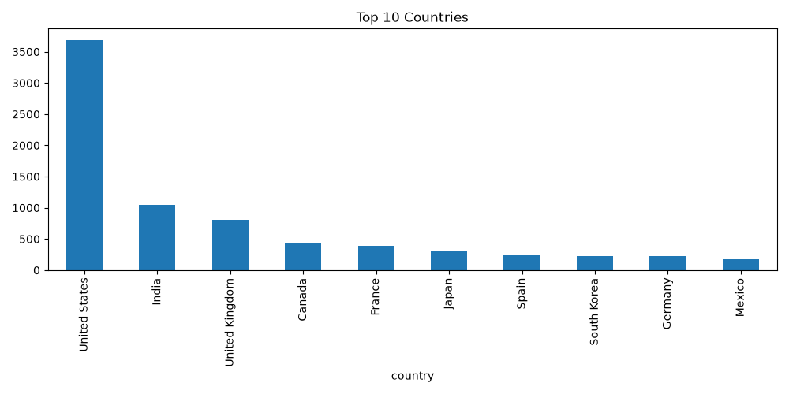
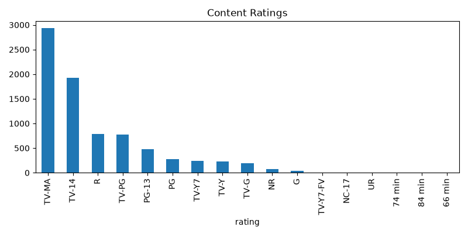

# 🎬 Netflix Business Analytics Dashboard
## 📌 Overview
A Python-based analytics dashboard exploring Netflix's content library using data visualization and business insights.
---
## 📊 Dashboard Preview
### Content Type Distribution

### Release Year Trend

### Top Genres

### Top Producing Countries

### Ratings Distribution

---
## 🚀 Features
- Movies vs TV Shows analysis
- Release year trend
- Top producing countries
- Content ratings analysis
- Genre analysis
- Business insights report
---
## 🛠 Technologies

- Python
- Pandas
- Matplotlib
---
## 📁 Project Structure
```
Netflix-Business-Analytics-Dashboard/
│
├── charts/
├── data/
├── report/
├── dashboard.py
├── README.md
└── requirements.txt
```
---
## ▶️ Run
```bash
pip install -r requirements.txt
python dashboard.py
```
---
## 📈 Business Insights
- Movie content dominates the platform.
- Netflix rapidly expanded after 2015.
- Drama and Comedy are the leading genres.
- TV-MA is the most common maturity rating.
- Content is concentrated in a few major countries.
---
## 👤 Author
**Aswanth K**
